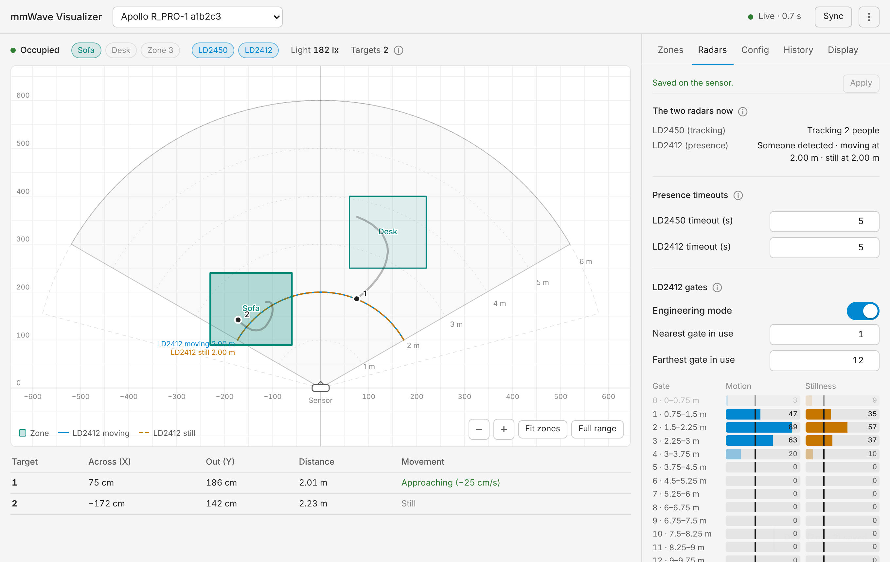

# Apollo R PRO-1 (ESPHome)

The Visualizer also works with the [Apollo Automation R PRO-1](https://github.com/ApolloAutomation/R_PRO-1), a PoE multisensor with two mmWave radars:

- an **LD2450**, which tracks where up to three people are and holds three rectangular zones;
- an **LD2412**, which only measures distance but reacts fast and holds on to someone sitting still.



The sensor isn't a Zigbee device. ESPHome exposes everything it knows as Home Assistant entities, and the addon reads and writes those through Home Assistant. No MQTT, no quirk and no extra firmware is needed: Apollo's stock firmware works as it ships.

Any other ESPHome device whose LD2450 entities have the same names ("LD2450 Target-1 X" and so on) is listed too, but only the R PRO-1 has been set up for.

## Setup

1. Add the R PRO-1 to Home Assistant with the ESPHome integration, as Apollo's guide describes.
2. In the addon's **Configuration** tab set `zigbee_stack` to `esphome` and restart the addon. (`apollo` works too. The option keeps its name from the Zigbee switches.)
3. Open the addon. The sensor is in the list at the top.

The MQTT options are ignored in this mode. An addon instance shows either Inovelli switches or ESPHome sensors, not both.

### Standalone Docker

Outside Home Assistant OS, point the container at Home Assistant with a long-lived access token (your profile page in Home Assistant, Security, Long-lived access tokens):

```yaml
environment:
  - ZIGBEE_STACK=esphome
  - HA_URL=http://homeassistant.local:8123
  - HA_TOKEN=your_long_lived_access_token
```

## First look: which way is left?

Stand in front of the sensor and step to one side. If your dot moves the other way on the map, open the **Display** tab and turn on **Mirror left and right**. Which way the radar counts depends on how the sensor is mounted, so check it once before drawing zones. It only changes the picture; zones stay where they are in the room.

The same tab places the sensor in your room (Arrange on map), which is worth doing for a ceiling mount.

## What you get

- **Live map** of the people the LD2450 tracks, with their speed and distance in the table underneath.
- **Zones**: draw, drag and resize the LD2450's three zones, name them, back them up and undo changes. Each zone shows its target count sensor's entity ID to use in automations, and its chip above the map lights up while someone is inside.
- **Zone type**, at the top of the Zones tab. It applies to all three zones at once and the radar itself enforces it:
  - *Off*: the radar tracks everywhere and the zones only count people.
  - *Detection*: the radar only reports people inside a zone.
  - *Filter*: the radar ignores everything inside a zone (a fan, a curtain, a doorway onto a hallway). The zones are then drawn hatched in red and their counts stay at 0.
- **LD2450 and LD2412 chips** showing which radar sees someone. *Occupied* means either does.
- **LD2412 distance arcs** on the map, once you enable its distance sensors (below).
- **Radars tab**: both presence timeouts, and the LD2412's 14 gates drawn as energy bars against their thresholds when engineering mode is on. This is the quickest way to see which gate a ceiling fan lights up, or whether the gate over your sofa passes its stillness threshold.
- **Config tab**: the settings of both radars, including every gate threshold, each with an explanation. Changes wait until you press Apply.
- **Radar tools**: calibrate, restart or factory reset either radar.
- **History**: the heat map and the timeline of occupancy and zone changes, as for the switches.

## Entities Apollo ships disabled

Some of the sensor's entities are disabled by default in Home Assistant. The page works without them and says what's missing:

| Enable | To get |
|---|---|
| LD2412 Moving Distance, LD2412 Still Distance | The LD2412's arcs on the map and its distances in the Radars tab |
| LD2412 Distance resolution, Light Function, Light Threshold, Hardware output pin level; LD2450 Multi Target Tracking | Those settings in the Config tab (greyed out until then) |
| LD2450 Firmware, LD2412 Firmware | The radars' firmware versions under This sensor |

Enable them on the device's page in Home Assistant (click the entity, the cog, then Enabled). Home Assistant takes about half a minute to bring them up, and the addon follows on its own. Press **Sync** if the page hasn't caught up.

## Good to know

- **Positions update about once a second.** The firmware rate-limits the LD2450's sensors to that before they reach Home Assistant, so dots move in steps. The presence sensors aren't rate-limited.
- **A zone save takes a few seconds.** A zone is four number entities and the radar re-reads its zone table after each one, so the addon writes them one at a time and checks the result. The zone is drawn dashed until the sensor confirms it.
- **Zones reach 486 cm either side and 756 cm out**, the LD2450's limits. A zone drawn past them is trimmed when you save it.
- **No heights.** The LD2450 sees a flat floor plan, so zones have width and depth only.
- **Units.** The page works in centimetres. If your Home Assistant shows the sensor's lengths in inches, the addon converts both ways.
- **Three targets, three zones.** That's what the LD2450 has.
- The hold time and sit-still tests, interference auto-detect and stay areas belong to the Inovelli switches and aren't shown for the sensor.

## Troubleshooting

- **No sensors found.** Check the R PRO-1 shows up under Settings, Devices & services, ESPHome, and that `zigbee_stack` is `esphome`. Then press Sync. The addon log (its Log tab) says how many sensors and entities it follows.
- **"The LD2450's position entities are disabled"**: enable "LD2450 Target-1 X" and "Y" (and targets 2 and 3) on the device's page.
- **"The sensor is offline"**: its entities are unavailable in Home Assistant. Check power and network.
- **Nobody shows up with the zone type on Detection**: the radar only reports people inside a zone, so draw one first or set the type back to Off.
- **A setting is greyed out**: its entity is disabled; see the table above.

Download diagnostics from the ⋮ menu to attach to a bug report.

## Trying it without a sensor

`tests/fake_ha.py` is a small stand-in for Home Assistant with a simulated R PRO-1 on it, which the tests use. To open the page against it:

```bash
python tests/fake_ha.py
```

```bash
ZIGBEE_STACK=esphome HA_URL=http://127.0.0.1:8123 HA_TOKEN=anything DATA_DIR=/tmp/mmwave python mmwave_vis/app.py
```

Then open `http://127.0.0.1:5000`. Two simulated people walk around in front of the sensor.
